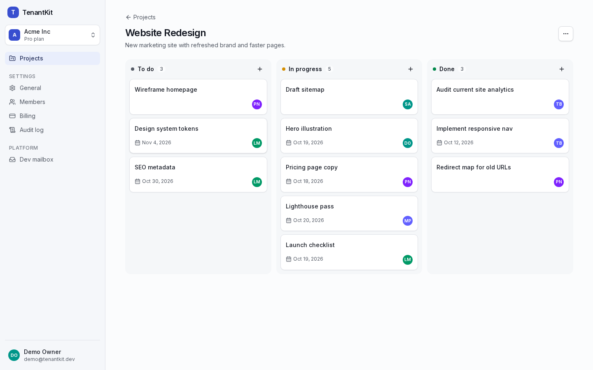
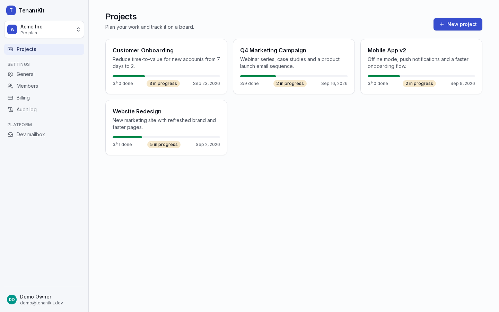
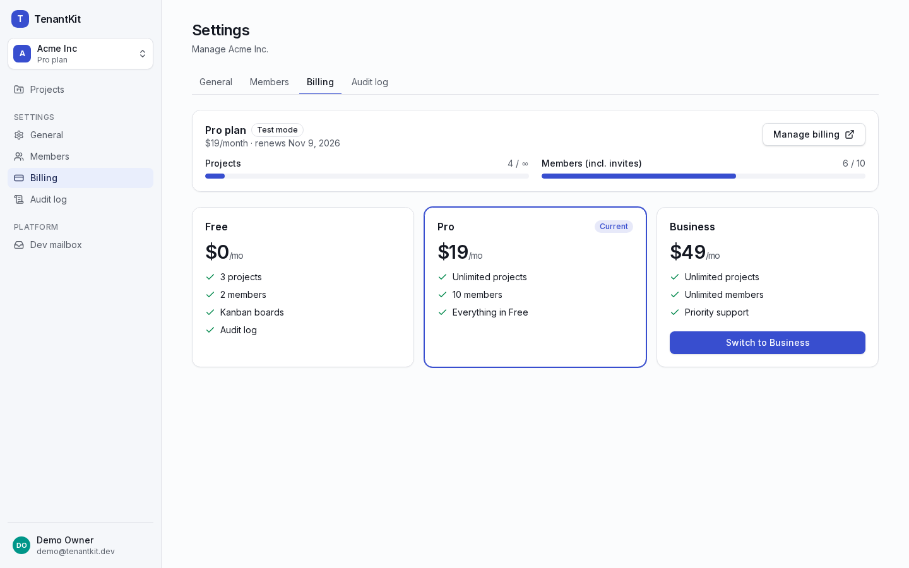
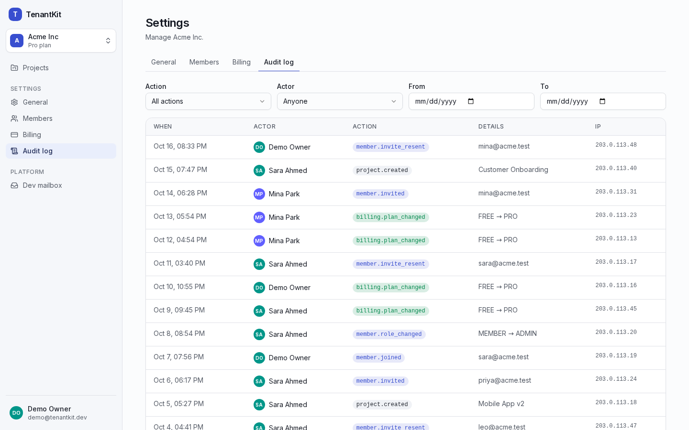
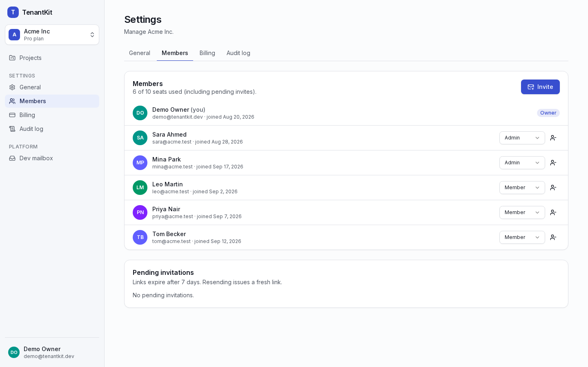
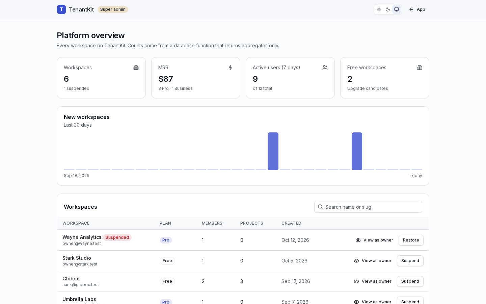
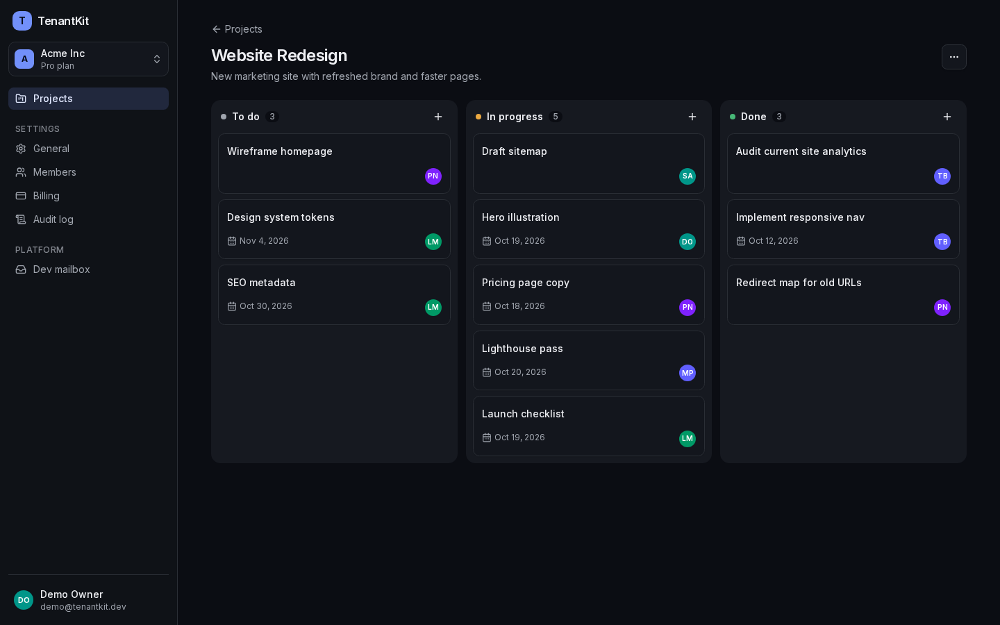
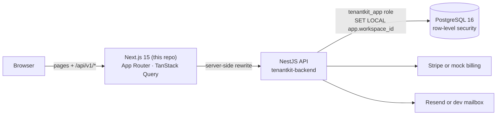

# TenantKit — Web App

**Multi-tenant SaaS starter UI** built with Next.js 15: workspaces and a workspace switcher, members and
magic-link invites, a drag-and-drop Kanban, Stripe billing with upgrade prompts, a filterable audit log,
a super-admin panel, dark mode, and a responsive layout down to 375 px.

> The API (NestJS, PostgreSQL row-level security, Stripe) lives in **[tenantkit-backend](https://github.com/Md-Huzaifa-Islam/tenantkit-backend)**.
> Everything runs locally with Docker and **no API keys**.



| Projects | Billing & plan limits | Audit log |
|---|---|---|
|  |  |  |
| **Members & invites** | **Super admin** | **Dark mode** |
|  |  |  |

## Architecture



More detail (session handling, routing, data flow): [docs/architecture.md](docs/architecture.md).

## Features

- **Auth:** sign up (creates your first workspace), login, forgot/reset password, email verification, and invite acceptance that signs you straight in. The access token lives in memory only; sessions restore from an httpOnly cookie with single-flight refresh.
- **Workspaces:** switcher, create workspace, rename, custom URL, logo upload, ownership transfer, delete.
- **Members:** role changes and removal (owner protections), invites with resend and revoke, seat usage.
- **Projects & Kanban:** progress cards, dnd-kit board with mouse, touch and keyboard drag, and optimistic updates that roll back if the API refuses.
- **Billing:** plan cards, usage meters, upgrade through Stripe Checkout (or a mock checkout page), Customer Portal, and a global **upgrade prompt** whenever the API reports a plan limit.
- **Audit log:** filter by action (or a whole group like `member.*`), actor and date range, with pagination.
- **Super admin:** MRR, active users, a signup chart, a workspace table with suspend/restore, and **read-only "View as owner"** with a banner.
- **Permission-aware UI:** actions are hidden using the same permission matrix the API enforces (`src/lib/shared/permissions.ts`).
- **Polish:** dark/light/system themes, skeleton loaders, empty states, toasts, a skip link, labelled controls, responsive to 375 px.

## Quick start

Start the backend first (it creates the shared `tenantkit-net` Docker network):

```bash
# in tenantkit-backend
docker compose up -d --build && docker compose exec api node dist/seed/seed.js
```

Then, in this repo:

```bash
docker compose up -d --build     # web on http://localhost:3000
```

| Email | Password | What you'll see |
|-------|----------|-----------------|
| `demo@tenantkit.dev` | `Demo1234!` | Owner of **Acme Inc** (Pro); member of **Globex** (Free, at its limits) |
| `admin@tenantkit.dev` | `Admin1234!` | Super-admin panel at `/admin` |

Emails (invites, resets, verification) appear at **http://localhost:3000/dev/mailbox**.

## Development

```bash
pnpm install
API_INTERNAL_URL=http://localhost:4000 pnpm dev   # needs the backend on :4000
pnpm lint && pnpm typecheck && pnpm test          # unit tests (Vitest)
```

| Variable | Default | Purpose |
|----------|---------|---------|
| `API_INTERNAL_URL` | `http://api:4000` | Where `/api/v1/*` is proxied. Baked in at build time (Docker build arg). |
| `WEB_PORT` | `3000` | Host port for the container |
| `E2E_BASE_URL` | `http://localhost:3000` | Playwright target |

## Testing

| Layer | Tool | What it covers |
|-------|------|----------------|
| Unit | Vitest (13 tests) | Token refresh and retry, single-flight refresh, impersonation never refreshes, error mapping, safe redirects, permission matrix |
| End-to-end | Playwright (3 flows) | Sign up → create project → add task · invite → accept as a new user · hit the Free limit → mock checkout → Pro → limit lifted |
| Backend | Jest (181 tests, in the API repo) | RLS and isolation (53 cases), RBAC, auth rotation, billing idempotency, audit |

```bash
pnpm exec playwright install chromium
pnpm test:e2e          # against the running Docker stack
```

Repeated e2e runs from one machine can hit the API's 10/min auth rate limit, because locally every request comes from the web container. For test runs, set `AUTH_RATE_LIMIT_PER_MINUTE=1000` in the backend's `.env`.

**Lighthouse** (Docker production build, signed in): dashboard **100 / 100 / 100** on desktop and **94 / 100 / 100** on throttled mobile (performance / accessibility / best practices). Details: [docs/lighthouse.md](docs/lighthouse.md).

## Docker

| Task | Command |
|------|---------|
| Build & start | `docker compose up -d --build` |
| Stop | `docker compose down` |
| Logs | `docker compose logs -f web` |
| Point at another API | `API_INTERNAL_URL=https://api.example.com docker compose build` |

The image uses Next.js standalone output. It runs as the non-root `node` user with a healthcheck at `/api/health`.

## CI

`.github/workflows/ci.yml` runs lint, typecheck, unit tests, a production build and a Docker build. An **e2e** job boots the backend repo's compose plus this web image and runs Playwright. It runs while the repositories are public, or when a `BACKEND_REPO_TOKEN` secret and the `E2E_WITH_TOKEN` variable are configured.

## Project layout

```
src/app/            App Router routes: (auth), [workspace], admin, dev, billing (mock pages)
src/components/     ui/ (shadcn-style primitives), shell/, kanban/, auth/
src/lib/            api client, queries, types, shared/ (permission matrix, plans, Zod schemas)
e2e/                Playwright smoke flows
docs/               architecture, lighthouse, screenshots, portfolio kit, checklist
requirements/       PROJECT_REQUIREMENTS.md (product spec)
```

Decisions: [DECISIONS.md](DECISIONS.md) · build log: [PROGRESS.md](PROGRESS.md) · Upwork case study and Loom script: [docs/PORTFOLIO.md](docs/PORTFOLIO.md).
