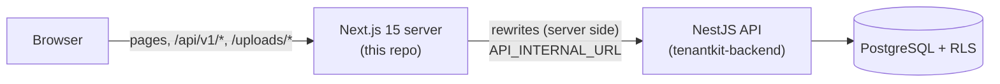
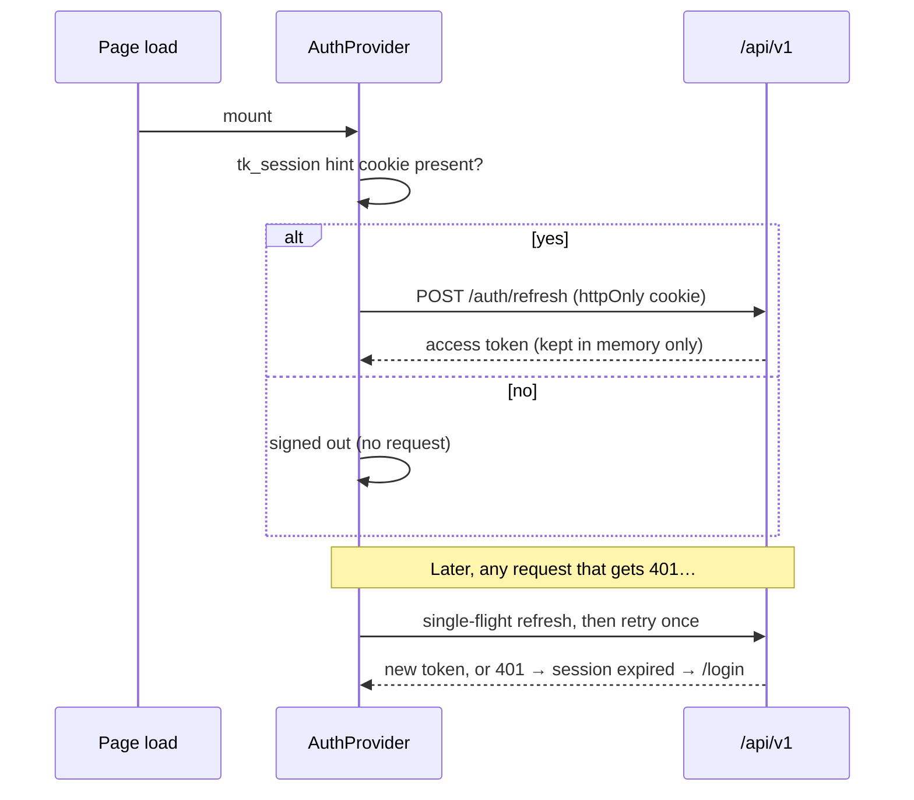

# TenantKit — Frontend Architecture

## Topology

The browser only ever talks to the web origin, and Next.js proxies `/api/v1/*` to the API.
That keeps the refresh-token cookie first-party (`SameSite=Lax`, `Path=/api/v1/auth`) and
removes CORS from the browser path.

## Session handling

- The access token is never written to `localStorage`/`sessionStorage`.
- Concurrent 401s share **one** refresh request. The backend treats a second use of a refresh token as theft and revokes the session.
- Read-only impersonation tokens are never refreshed; when they expire the admin returns to their own session.

## Routing

| Route | Purpose |
|-------|---------|
| `/` | Landing page; signed-in users are redirected to their first workspace |
| `/(auth)/login, signup, forgot, reset, verify, invite/[token]` | Auth flows |
| `/[workspace]/projects`, `/[workspace]/projects/[id]` | Project list and Kanban board |
| `/[workspace]/settings/{general,members,billing,audit-log}` | Workspace settings |
| `/admin` | Super-admin panel |
| `/dev/mailbox` | Emails captured by the backend's mock email provider |
| `/billing/mock-checkout`, `/billing/mock-portal` | Stand-ins for Stripe Checkout/Portal in keyless mode |

The `[workspace]` layout resolves the slug against `/me/workspaces`. It provides the role and
permissions through `WorkspaceProvider`, so components ask `can('member.invite')`. That uses
the same matrix the API enforces (`src/lib/shared/permissions.ts`). Top-level route names are
reserved slugs on the backend, so a workspace can never shadow them.

## Data flow

- **TanStack Query** for server state, with keys in `src/lib/queries.ts`. Mutations invalidate the affected keys.
- **Kanban:** dnd-kit (pointer and keyboard sensors). A drop updates local state and the query cache optimistically, then `POST /tasks/reorder` sends the affected columns. If the API refuses (e.g. a member moving someone else's task across columns), the board snaps back and shows a toast.
- **Plan limits:** any `402 PLAN_LIMIT_REACHED` opens a global upgrade dialog (`handlePlanLimit`).
- **Forms:** React Hook Form with the same Zod schemas the API validates with. API field errors map back onto inputs.
